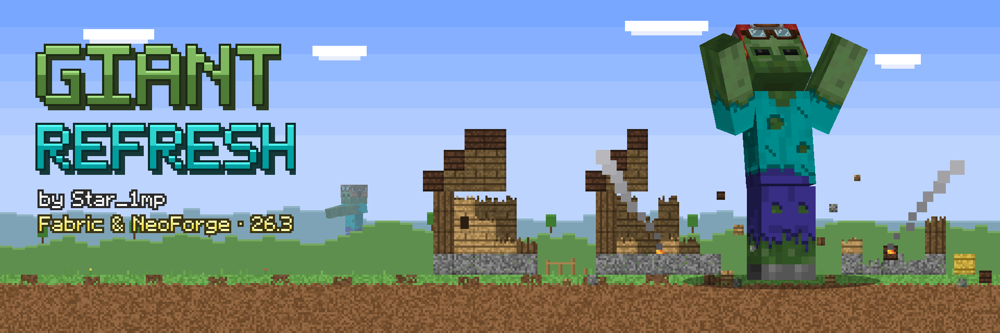

# Giant Refresh

**Author:** Star_1mp · **Minecraft:** 1.21.6 – 26.3 · **Loaders:** Fabric & NeoForge

Giant Refresh turns the forgotten, unused Giant into a real inhabitant of the world — a rare,
huge and dangerous mob that still looks like something Mojang could have added.

## Downloads
One archive per Minecraft range; every archive holds both the Fabric and the NeoForge jar —
put the one for your loader into `mods/`. The content is the same on every version.

| Archive | Minecraft | Fabric jar (+ Fabric API) | NeoForge jar |
|---|---|---|---|
| `giant_refresh-1.0.0-mc26.3` | 26.3 | `giant_refresh-fabric-1.0.0+mc26.3.jar` | `giant_refresh-neoforge-1.0.0+mc26.3.jar` |
| `giant_refresh-1.0.0-mc26.2` | 26.2 | `giant_refresh-fabric-1.0.0+mc26.2.jar` | `giant_refresh-neoforge-1.0.0+mc26.2.jar` |
| `giant_refresh-1.0.0-mc26.1-26.1.2` | 26.1, 26.1.1, 26.1.2 | `giant_refresh-fabric-1.0.0+mc26.1-26.1.2.jar` | `giant_refresh-neoforge-1.0.0+mc26.1-26.1.2.jar` |
| `giant_refresh-1.0.0-mc1.21.11` | 1.21.11 | `giant_refresh-fabric-1.0.0+mc1.21.11.jar` | `giant_refresh-neoforge-1.0.0+mc1.21.11.jar` |
| `giant_refresh-1.0.0-mc1.21.9-1.21.10` | 1.21.9, 1.21.10 | `giant_refresh-fabric-1.0.0+mc1.21.9-1.21.10.jar` | `giant_refresh-neoforge-1.0.0+mc1.21.9-1.21.10.jar` |
| `giant_refresh-1.0.0-mc1.21.6-1.21.8` | 1.21.6, 1.21.7, 1.21.8 | `giant_refresh-fabric-1.0.0+mc1.21.6-1.21.8.jar` | `giant_refresh-neoforge-1.0.0+mc1.21.6-1.21.8.jar` |

## The Giant
- 12 blocks tall, 200 HP, slow and heavy. Every step thumps, kicks up dirt and lightly shakes the camera.
- Looks and moves like the vanilla Giant should have: the zombie model ×6 with the zombie's own arms-out
  walk, a 2× detailed skin (rotting trousers, mossy shins), and a few big, readable poses for its attacks,
  its roar, sleeping (sitting) and waking up. It falls over sideways when it dies, like any other mob.
- **Three telegraphed attacks** (each has a clear wind-up so you can dodge):
  - *Slam* — raises both fists high overhead, trembles, then crashes them down in front of it.
  - *Stomp* — lifts a leg high in front for a long moment, then sends a shockwave through the ground.
  - *Scoop* — a wide underarm sweep that flings small creatures and players into the air.
  - *Grab* — reaches out (down in front, forward-up, or straight up), closes its fist on you, lifts you
    high over its head and hurls you at the ground. Building a pillar no longer keeps you safe: anything
    up to ~15 blocks above the ground within reach gets plucked off. Sneaking does not get you out —
    hitting the Giant from inside its fist sometimes makes it let go.
- Breaks leaves, flowers, tall grass, fences, wooden doors and trapdoors in its way (respects `mobGriefing`).
- Crushes plants and trampled crops underfoot, can squash small animals, leaves coarse-dirt footprints.

## The harness hat & riders
Many Giants wear a **harness hat** — the Happy Ghast harness in one of the 16 vanilla colours, with the
same goggles (up when empty, pulled down when ridden). The hat is a mobile fortress for 2–3 hostile riders:
zombies (jump down to fight nearby enemies), skeletons (shoot from above), husks (do not burn by day),
drowned with tridents and witches, in several crew combinations (the rare war party is the nastiest).
Kill the riders first — the fight gets much easier.

**Spiders** climb a Giant like a wall: at night (or when hunting) they run up to it, crawl up its body
and settle on its head — hat or no hat — then leap down on silk at anyone who comes close.

## In the world
- **Footprint trails** generate in plains, forests, meadows, savannas and taigas. Prints get fresher and
  closer together along the trail; rare *camps* end with a **sleeping Giant** next to its lair.
  Some trails start at a **trampled settlement**: broken huts with knocked-down walls, scattered debris
  and a deep footprint right through the middle.
- Sleeping Giants wake up when you sprint nearby, come too close or attack them — sneak past!
- Rare natural spawns in the same biomes (at night; daytime Giants are found napping), sometimes with a small zombie horde.
- Zombies gather around Giants, skeletons stay close for cover.
- Iron golems see a Giant as the biggest threat around: they spot it from far away and drop other targets for it.
- Villages: a Giant wanders into villages, breaks what blocks its way and attacks golems and villagers.
  Villagers panic and run home to hide, exactly as if the bell had been rung.
- A Giant stamping down right next to a creeper often sets it off — and the blast hurts the Giant too.
- A vanilla `minecraft:giant` (e.g. from `/summon`) is automatically replaced with the new Giant.

## Loot
- Lots of rotten flesh.
- **Giant Tooth** (rare) → brew *Awkward Potion + Giant Tooth* = **Potion of Growth**
  (redstone extends it, gunpowder / dragon's breath work as usual). You smoothly grow to about 5 blocks
  tall, move a bit slower but hit harder and reach further; you shrink back just as smoothly.
  Add a **fermented spider eye** to get a **Potion of Shrinking** (half size, weaker hits; redstone,
  gunpowder and dragon's breath work too). Neither potion — nor its splash, cloud or arrow — works on Giants.
- **Giant Head** (rare, guaranteed from a charged creeper) — a huge decorative head block.

## Config
`config/giant_refresh.json` — Giant stats, block breaking, footprints, spawn rates, hat/rider chances,
mob behaviour (spiders, creepers, golems, villagers), trampled settlements, screen shake and Growth / Shrinking strength.

## Building
The sources are written for the newest version (26.3); version differences are marked with
`//#if MC >= x` blocks and per-version settings live in `versions/<target>.properties`
(`tools/preprocess.py` writes the sources for a target to `build/gen/<target>`).
```
cd fabric && gradle build -Pgr_target=26.3            # 26.x Fabric
cd fabric-remap && gradle build -Pgr_target=1.21.11   # 1.21.x Fabric
cd neoforge && gradle build -Pgr_target=1.21.9        # any target
```
Targets: `26.3`, `26.2`, `26.1`, `1.21.11`, `1.21.9`, `1.21.6`. GitHub Actions builds every target,
uploads one archive per target and runs the self test on real servers of every supported
Minecraft version.
